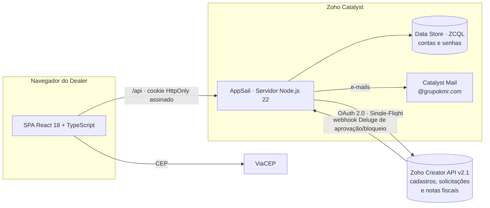
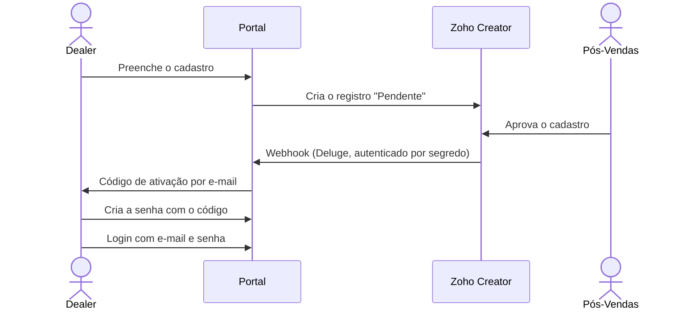
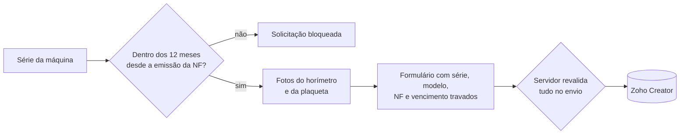

# Portal de Pós-Vendas B2B · Grupo KMR (HVR Mac & HELI Brasil)

> **Case de Engenharia Full Stack:** Plataforma web *multi-brand* projetada e desenvolvida de ponta a ponta em 5 semanas para substituir o portal nativo do Zoho Creator, automatizando o onboarding de concessionárias (dealers), permitindo visibilidade multiusuário por CNPJ e blindando a operação de Pós-Vendas com validações estritas no servidor (BFF).


<sub>Todas as capturas usam dados fictícios, com o portal em modo de demonstração.</sub>

---

## Sumário

- [O Problema de Negócio](#o-problema-de-negócio)
- [Impacto e Escopo em Números](#impacto-e-escopo-em-números)
- [Desafios de Engenharia e Soluções Técnicas](#desafios-de-engenharia-e-soluções-técnicas)
- [Arquitetura e Stack](#arquitetura-e-stack)
- [Segurança e Proteção de Dados](#segurança-e-proteção-de-dados)
- [Módulos de Negócio e Experiência de Uso](#módulos-de-negócio-e-experiência-de-uso)
- [Qualidade, Testes e CI/CD](#qualidade-testes-e-cicd)
- [Estrutura do Projeto](#estrutura-do-projeto)

---

## O Problema de Negócio

A operação interna de Pós-Vendas do **Grupo KMR** (marcas **HVR Mac** e **HELI Brasil**) é gerida no **Zoho Creator**. Porém, utilizar o Portal nativo do Zoho Creator para atender a rede externa de concessionárias (dealers) gerava gargalos operacionais para o cliente, para o Pós-Vendas e para a TI:

| Gargalo no Modelo Antigo (Portal Nativo Zoho) | Solução Projetada (Portal Próprio Full Stack) |
| :--- | :--- |
| **Visibilidade engessada (Por Usuário vs. Por Empresa):** Por segurança, o Creator restringia cada usuário a ver apenas os chamados que ele mesmo abriu (para não expor dados de outras empresas). Com isso, **gestores e colegas do mesmo CNPJ não conseguiam acompanhar solicitações abertas pela própria equipe**. | **Isolamento Multi-Tenant por CNPJ:** Autenticação própria onde cada pessoa tem seu login individual (`password_dealers`), mas a visibilidade de listas, detalhes e anexos é filtrada no servidor pelo **CNPJ da sessão** — permitindo visão compartilhada na equipe com isolamento total entre concessionárias. |
| **Onboarding manual envolvendo 3 setores:** O portal nativo só guardava Nome e E-mail. O Pós-Vendas precisava abrir chamado para a **TI** cadastrar o e-mail no portal, aguardar o aceite do cliente e, só depois, preencher um registro separado com os dados da concessionária. | **Auto-cadastro com aprovação em 1 clique:** O dealer preenche todos os dados empresariais e de endereço em `/cadastro`. O registro já cai completo no Creator como `Pendente`. Quando o Pós-Vendas aprova, um **webhook em Deluge** aciona o portal, que provisiona a conta e envia o código de ativação sem acionar a TI. |
| **Convites perdidos no Spam e confusão de acesso:** Os convites padrão da Zoho caíam com frequência no spam e os clientes confundiam o login do Portal Creator com outros aplicativos do ecossistema Zoho. | **Domínio próprio e Código de Ativação:** E-mails transacionais enviados sob o domínio `@grupokmr.com`. Além disso, o código de ativação de 6 dígitos é gravado no registro do Creator para que o Pós-Vendas possa repassá-lo caso o servidor de e-mail do cliente retenha a mensagem. |
| **UX confusa e falhas de preenchimento:** O dealer visualizava *reports* crus dos formulários internos, sem validação prévia de faturamento ou de prazo de garantia. | **UX guiada e validação Server-Side:** Interface intuitiva e dedicada por marca, autopreenchimento via base de Notas Fiscais, bloqueio automático de garantias fora do prazo de 12 meses e reaproveitamento automático de anexos entre módulos. |

---

## Impacto e Escopo em Números

| Indicador | Resultado |
| :--- | :--- |
| **Escopo Funcional** | **3 módulos críticos** (Entrega Técnica, Documentação e Garantia) + **Entregas Atribuídas**, nas **2 marcas** |
| **Arquitetura Multi-Brand** | **1 única base de código** parametrizada (`BRAND_CONFIG`) com identidade visual própria para HVR Mac e HELI Brasil |
| **Backend Proprietário** | **40 endpoints HTTP** em Node.js puro (`node:http`), sem Express/Fastify, com apenas **1 dependência de runtime** no servidor |
| **Qualidade e Cobertura** | **334 testes automatizados** em **28 suítes** (`node:test`), rodando 100% *offline* com dublês de rede e banco |
| **Volume e Entrega** | **~25 mil linhas de código** (11,5k no front, 7,2k no servidor e 6,2k de testes) entregues em **5 semanas** (11/09 a 14/10/2026) |

---

## Desafios de Engenharia e Soluções Técnicas

Construir uma camada BFF (*Backend-for-Frontend*) resiliente sobre uma plataforma low-code exigiu resolver limitações reais de API, rede e memória:

### 1. Concorrência de OAuth e Bloqueio de Refresh Token (*Single-Flight Pattern*)
* **Problema:** A API do Zoho Creator exige tokens OAuth 2.0 temporários. Quando múltiplas requisições chegavam ao servidor com o cache expirado, cada chamada disparava uma renovação paralela. O Zoho interpretava a rajada como abuso (`"You have made too many requests continuously"`) e bloqueava o *refresh token*, derrubando as integrações.
* **Solução (`server/zohoAccessToken.mjs`):** Implementei um gerenciador centralizado com padrão *Single-Flight*. Se múltiplas requisições simultâneas encontram o token vencido, apenas 1 vai à rede renovar enquanto as demais aguardam a mesma `Promise`. Adicionei também *cooldown* automático (15s para recusas comuns e 120s para *throttling*) e descarte seletivo (`staleValue`) em caso de `HTTP 401`.

### 2. "Falhas Silenciosas" da API do Zoho Creator (Camada Anticorrupção)
* **Problema:** A API REST v2.1 do Creator descarta silenciosamente campos com nomes divergentes no JSON, exige o `recordId` interno em campos *lookup*, recusa o registro inteiro se um valor de *dropdown* divergir e responde códigos de erro (`3100`, `9220`, `9280`) quando um relatório está apenas vazio.
* **Solução:**
  * Todos os *link names* foram conferidos contra a metadata dos formulários e isolados em mapeadores explícitos com validação prévia no servidor.
  * Operação em modo ***fail-closed* por marca**: se uma marca não estiver configurada no ambiente, o servidor retorna `503 BRAND_NOT_CONFIGURED` em vez de correr o risco de gravar dados de uma marca no formulário da outra.
  * Na listagem de **Entregas Atribuídas (HELI)**, onde o campo `CNPJ1` no Creator podia vir mascarado, sem máscara ou como objeto de *lookup*, implementei leitura paginada via cursor (`record_cursor`) com **cache compartilhado de 60s + *single-flight*** e normalização em memória, preservando a cota de API da Zoho.

### 3. Uploads Pesados (até 50 MB), Validação por *Magic Bytes* e Backpressure
* **Problema:** O módulo de Documentação recebe até **17 anexos por envio** (incluindo vídeo do equipamento operando). Acumular múltiplos envios simultâneos em memória poderia derrubar o processo por *Out-Of-Memory (OOM)*, além do risco de arquivos maliciosos com tipo adulterado.
* **Solução:**
  * **Inspeção Binária (*Magic Bytes*):** O servidor valida a assinatura de bytes real de cada arquivo (PDF, PNG, JPEG, XML, MP4/QuickTime/WebM), ignorando o MIME type informado pelo navegador.
  * **Rejeição Precoce de Payload (`readJson`):** O tamanho é conferido no header `Content-Length` *antes* de alocar buffers e monitorado durante a leitura do stream.
  * **Semáforo de Concorrência (`uploadConcurrency.mjs`):** Limita o servidor a **6 uploads globais simultâneos** e no máximo **2 por usuário** (evitando que uma conexão lenta monopolize todas as vagas). Quem excede o limite recebe `503 SERVER_BUSY` com `Retry-After: 5` antes da leitura do corpo, e o front-end repete o envio automaticamente (3s, 6s e 10s).
  * **Cópia Server-to-Server de Nota Fiscal:** Na abertura de Garantia para máquina com Entrega Técnica do mesmo CNPJ, o servidor copia a Nota Fiscal diretamente entre os módulos no Zoho, sem o arquivo passar pelo navegador.

### 4. Idempotência e Retomada de Progresso em Redes Instáveis
* **Problema:** Se a resposta de rede caísse após o registro ter sido criado no Zoho (ou no meio da sequência de uploads de imagens), uma nova tentativa do usuário duplicaria a solicitação.
* **Solução (`idempotencyCache.mjs` + `warranty.mjs`):** Cada abertura de formulário gera um `requestId` único. O servidor mantém cache de idempotência por CNPJ e marca. Na Garantia, o servidor guarda inclusive o **progresso parcial**: se o registro já foi criado e parte das imagens já subiu antes de uma falha, o retry do mesmo `requestId` retoma do ponto em que parou e envia apenas os anexos restantes.

### 5. Servidor *Zero-Framework* (`node:http`)
* **Decisão:** O backend foi escrito diretamente sobre `node:http` com um roteador próprio (`router.mjs`), usando apenas `zcatalyst-sdk-node` como dependência externa de servidor.
* **Motivo:** Manter árvore de dependências mínima no ambiente serverless (Zoho Catalyst AppSail), controlar explicitamente os limites de leitura de corpo por rota e deixar a ordem de segurança visível em cada handler (autenticação, vaga de upload e rate limit executados antes de carregar payloads pesados na memória).

---

## Arquitetura e Stack



- **Mesma origem:** o servidor Node entrega o SPA compilado e a API, eliminando a necessidade de CORS.
- **Divisão dos dados:** o Zoho Creator continua sendo a fonte da verdade do negócio. O Catalyst Data Store guarda apenas os dados de autenticação (`password_dealers`: hash da senha, status, bloqueio e vínculo com o registro do Creator).
- **Credenciais isoladas:** nenhuma chave ou token do Zoho chega ao navegador.

| Camada | Tecnologias |
| :--- | :--- |
| **Frontend** | React 18, TypeScript (`strict`), Vite 6, React Router 6, Lucide Icons e CSS próprio parametrizado por marca, sem framework de UI |
| **Backend** | Node.js 22 (ESM, `node:http`, `node:crypto`), sem Express; `zcatalyst-sdk-node` |
| **Dados e integrações** | Zoho Creator (API REST v2.1, OAuth 2.0), Webhooks Deluge, Catalyst Data Store (ZCQL), Catalyst Mail e ViaCEP |
| **Infraestrutura** | Zoho Catalyst AppSail e Catalyst Pipelines (CI/CD) |
| **Qualidade** | `node:test`, ESLint 9, `typescript-eslint` e checagem de tipos no build |

---

## Segurança e Proteção de Dados

O projeto passou por uma análise de segurança de todo o código, com correções cobertas por testes automatizados:

- **Senhas e códigos de ativação:** hash `scrypt` com salt aleatório de 16 bytes e comparação em tempo constante (`timingSafeEqual`). O código de ativação de 6 dígitos é apagado do banco após **5 tentativas erradas**.
- **Sessão stateless com revogação:**
  - armazenada em cookie `HttpOnly`, `Secure` e `SameSite=Lax`, assinado com `HMAC-SHA256`;
  - expira por **inatividade (20 min)** e por **teto máximo desde o login (12 h)** — atualizações automáticas das listas em background (`X-PV-Background: 1`) não renovam a sessão à toa;
  - embute a versão da senha (`passwordVersion`): trocar ou redefinir a senha derruba todas as sessões abertas;
  - quando o Pós-Vendas bloqueia um cadastro no Creator, o webhook atualiza o banco e as sessões abertas daquela pessoa caem em até **1 minuto**.
- **Proteção de contas e Rate Limiting:**
  - fluxos públicos de senha não revelam se um e-mail possui cadastro;
  - rate limit em memória por IP, por conta e por usuário, com teto de 50.000 chaves contra exaustão de memória e leitura segura do `X-Forwarded-For` no gateway do AppSail.
- **Cabeçalhos HTTP e anti-CSRF:** Content Security Policy (CSP) sem script inline, HSTS, `X-Frame-Options: DENY`, `nosniff` e `Referrer-Policy: same-origin`. Contra CSRF entre apps do mesmo domínio `catalystappsail.com`, rotas `POST` exigem `Content-Type: application/json` e validação de `Sec-Fetch-Site`.
- **Downloads seguros (`fileDownload.mjs`):** apenas PDF, imagem e vídeo abrem inline no navegador; os demais formatos (como XML) saem forçados como `attachment` e `application/octet-stream`, evitando XSS por arquivo enviado.
- **Isolamento por empresa (Multi-Tenant):** listas, detalhes e downloads são filtrados pelo CNPJ da sessão. Tentar acessar um registro de outra empresa retorna `404`, sem confirmar que o ID existe.
- **Erros sem vazamento:** detalhes técnicos das recusas do Zoho ficam restritos ao log do servidor; o navegador recebe apenas uma mensagem genérica e o código de erro.
- **Trava tripla contra modo de demonstração:** os mocks de demonstração possuem três travas e são desativados automaticamente em produção ou quando a porta nativa do AppSail (`X_ZOHO_CATALYST_LISTEN_PORT`) está presente.

---

## Módulos de Negócio e Experiência de Uso

### 1. Acesso e Gestão de Conta dos Dealers




- **Cadastro público e ativação autônoma:** cria um registro pendente no Creator. A aprovação dispara um webhook autenticado que provisiona a conta e envia por e-mail um código de 6 dígitos (também salvo no registro do Creator para consulta do Pós-Vendas).
- **Uma conta por pessoa, visão por CNPJ:** várias pessoas da mesma concessionária têm seu próprio login, todas enxergam as solicitações da empresa e cada chamado registra quem o abriu.
- **Minha Conta com troca de e-mail transacional:** permite editar nome, telefone e e-mail mediante confirmação da senha atual. O novo e-mail só passa a valer após confirmação por código de 6 dígitos; o servidor atualiza Creator e Data Store com **rollback automático** caso uma das pontas falhe, enviando aviso de segurança ao endereço antigo.

---

### 2. Dois Ambientes, Um Portal

Depois do login, o dealer escolhe o ambiente **HVR Mac** ou **HELI Brasil**. Cada ambiente segue a identidade visual oficial da sua marca (cores, tipografia e logos dos manuais de marca), operando sobre a mesma base de código parametrizada.


---

### 3. Entrega Técnica e Entregas Atribuídas

- **Busca da série na Base de Notas Fiscais:** autocomplete que consulta o report de Notas Fiscais (`Notas_Fiscais_n8n_Report`) e trava automaticamente o Modelo da Máquina e o Número da NF.
- **Uma solicitação por número de série:** o formulário verifica em tempo real se a série já possui Entrega Técnica e o servidor revalida no envio. Apenas uma solicitação marcada como `"Inadequada"` libera um novo pedido para a mesma máquina.
- **Campos específicos por marca:** suporte nativo às particularidades da HELI (bateria extra, carregador, instalação elétrica e espaço/montagem de torre).
- **Entregas Atribuídas (HELI):** aba dedicada para a concessionária consultar as entregas técnicas que o Pós-Vendas atribuiu ao seu CNPJ para execução, com visualização completa e download seguro dos anexos.

<table>
  <tr>
    <td width="50%">
      
      <br><sub>Acompanhamento das solicitações da empresa</sub>
    </td>
    <td width="50%">
      
      <br><sub>Nova solicitação, com a série buscada nas notas fiscais</sub>
    </td>
  </tr>
</table>

---

### 4. Documentação da Entrega Técnica

- **Comprovação completa de campo:** reúne dados do cliente, técnico, condições do local, dados comerciais/financeiros e **17 anexos** (fotos dos quatro vértices, plaquetas, horímetro, piso irregular, avarias, checklist, certificado de garantia, relatório técnico, orçamento, nota fiscal e vídeo do equipamento operando de até 50 MB).
- **Pré-preenchimento inteligente:** ao selecionar a série, o sistema busca automaticamente os dados comerciais/fiscais na Nota Fiscal (vendedor, canal/centro de custo, tipo, ICMS, DIFAL e valor líquido, calculando o valor bruto) e aproveita os dados de cliente e endereço da Entrega Técnica do próprio dealer.
- **Uma documentação por série** em cada marca, liberando novo envio apenas em caso de documentação indeferida.

---

### 5. Garantia



- **Etapa 1 — Validação de elegibilidade:** consulta a série nas Notas Fiscais e calcula os 12 meses de garantia a partir da emissão da nota por funções puras no fuso `America/Sao_Paulo` (com o último dia incluído). Máquinas fora do prazo ou séries com notas duplicadas são barradas antes do preenchimento.
- **Etapa 2 — Solicitação travada e revalidada:** série, modelo, nota fiscal, data de vencimento e fotos iniciais chegam travados. O campo *"Possui Entrega Técnica?"* é apurado pelo servidor, que também copia a Nota Fiscal diretamente da Entrega Técnica quando ela pertence ao mesmo dealer.
- **Auditoria LGPD:** cada consulta de garantia é registrada no servidor com o número de série mascarado.


---

### 6. Experiência de Uso em Campo

- **Rascunhos no navegador:** os formulários guardam até 2 rascunhos locais por módulo/marca, válidos por 1 hora, com contagem regressiva em tempo real.
- **Fechamento protegido:** modais de formulário não fecham com clique fora ou `Esc`. Ao clicar no `X` com campos preenchidos, o portal pergunta se o dealer deseja salvar como rascunho.
- **Layout responsivo e máscaras:** menu lateral retrátil que vira gaveta no celular, tabelas convertidas em cartões em telas móveis e suporte completo ao **novo CNPJ alfanumérico** (Receita Federal) tanto no front quanto no servidor.

<p align="center">
  
  <br><sub>No celular, as tabelas de acompanhamento viram cartões</sub>
</p>

---

## Qualidade, Testes e CI/CD

- **334 testes automatizados (`node:test`):** distribuídos em 28 suítes. O `fetch`, o Data Store e o envio de e-mail são injetados como dublês, permitindo rodar toda a suíte sem rede e sem credenciais.
- **CI/CD no Catalyst Pipelines:** a cada push na `main`, executa `npm ci → lint → typecheck → test → build → deploy` no ambiente de desenvolvimento, promovendo para produção pelo console após validação.
- **Engenharia Assistida por IA (Workflow em Fases):** para entregar ~25 mil linhas em 5 semanas mantendo rigor arquitetural e 334 testes passando, o desenvolvimento de cada tela foi estruturado em três etapas isoladas — **Estrutura** (markup e CSS fiel aos manuais de marca), **Lógica** (estado, validações e rascunhos) e **Integração** (API, segurança e contratos do Zoho) — orquestrando agentes especializados no Claude Code sob revisão humana entre cada fase.

---

## Estrutura do Projeto

```text
.
├── src/
│   ├── pages/                          # login, cadastro, ambientes, módulos, minha conta
│   ├── components/
│   │   ├── technicalDelivery/          # Entrega Técnica, Entregas Atribuídas, rascunhos, modal
│   │   ├── technicalDeliveryDocumentation/ # Documentação (17 anexos, dados fiscais e prefill)
│   │   ├── warranty/                   # validação e solicitação de garantia em 2 etapas
│   │   └── account/                    # edição de perfil e confirmação de troca de e-mail
│   ├── services/                       # clientes da API, expiração de sessão, retentativa
│   └── utils/                          # CNPJ alfanumérico e e-mail
├── server/
│   ├── index.mjs                       # servidor HTTP, 40 rotas, erros e entrega do SPA
│   ├── router.mjs                      # router zero-dependency de método + caminho
│   ├── authSession.mjs, authService.mjs, dealerAuth*.mjs   # contas, sessão, senha, webhook e perfil
│   ├── hvrTechnicalDelivery*.mjs       # Entrega Técnica, Documentação (2 marcas) e Atribuídas
│   ├── warranty*.mjs                   # Garantia: regras puras, serviço e auditoria
│   ├── notasFiscaisRepository.mjs      # consulta única de notas fiscais no Creator
│   ├── zohoAccessToken.mjs             # token OAuth compartilhado (Single-Flight)
│   ├── httpSecurity.mjs, fileDownload.mjs, uploadConcurrency.mjs
│   └── *.test.mjs                      # 28 suítes de testes automatizados (334 testes)
├── public/brands/                      # logos oficiais das marcas
└── catalyst-pipelines.yml              # pipeline de CI/CD
```

---

Desenvolvido por **Douglas Soares**.
<!-- Adicione aqui seus links: LinkedIn, GitHub ou e-mail -->
