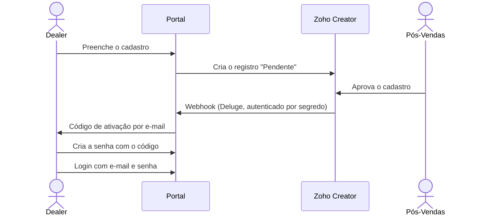
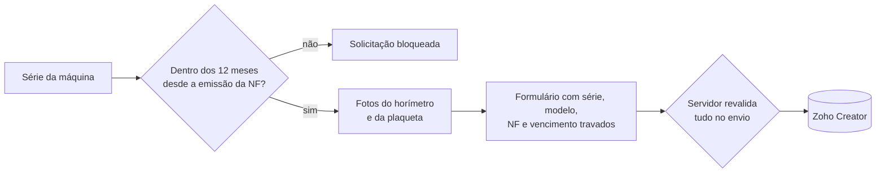
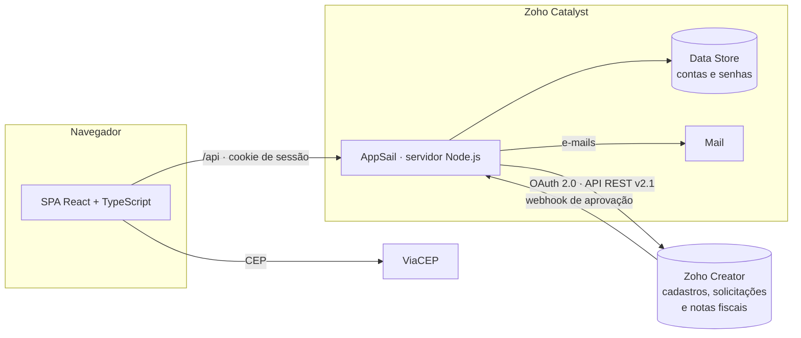

[README.md](https://github.com/user-attachments/files/33452278/README.md)
# Portal de Pós-Vendas · HVR Mac & HELI Brasil

Portal web full stack em que a rede de concessionárias (dealers) de duas marcas de máquinas
abre e acompanha as solicitações de pós-vendas: **Entrega Técnica**, **Documentação da
Entrega Técnica** e **Garantia**. O portal é integrado ao Zoho Creator, tem autenticação
própria e valida todas as regras de negócio no servidor.


<sub>Todas as capturas usam dados fictícios, com o portal em modo de demonstração.</sub>

## Sumário

- [Visão geral](#visão-geral)
- [Funcionalidades](#funcionalidades)
- [Arquitetura](#arquitetura)
- [Stack](#stack)
- [Destaques de engenharia](#destaques-de-engenharia)
- [Segurança](#segurança)
- [Qualidade e entrega](#qualidade-e-entrega)
- [Estrutura do projeto](#estrutura-do-projeto)
- [Como executar localmente](#como-executar-localmente)

## Visão geral

O Grupo KMR atende uma rede de dealers das suas duas marcas, **HVR Mac** e **HELI Brasil**.
O processo de pós-vendas é controlado no **Zoho Creator**.

O portal é a camada que o dealer enxerga. Nele, o dealer abre solicitações, anexa
documentos, fotos e vídeos e acompanha o status de cada pedido. O servidor aplica as regras
de negócio e é o único que conversa com o Zoho: nenhuma credencial chega ao navegador.

| Em números | |
| --- | --- |
| **3 módulos de negócio** | Entrega Técnica, Documentação e Garantia, nas duas marcas |
| **1 código para 2 marcas** | módulos parametrizados por marca, sem duplicação |
| **~40 endpoints** | API própria em Node.js, sem framework HTTP |
| **334 testes automatizados** | 28 suítes, sem nenhuma dependência de rede |
| **~25 mil linhas** | 11,5 mil no front, 7,2 mil no servidor e 6,2 mil de testes |
| **5 semanas** | 29 commits, de 11/09 a 14/10/2026 |

## Funcionalidades

### Acesso dos dealers




- **Cadastro público** que cria um registro pendente no Creator. A aprovação continua com o
  Pós-Vendas, dentro do Creator.
- **Ativação por código:** a aprovação dispara um webhook que cria a conta e envia por e-mail
  um código de 6 dígitos. Há botão "Reenviar código" e fluxo de "Esqueci minha senha" com
  link de redefinição.
- **Uma conta por pessoa:** login com e-mail e senha. Várias pessoas da mesma empresa têm
  cada uma o próprio acesso, todas veem as solicitações da empresa e cada solicitação mostra
  quem a abriu.
- **Desligamento pelo Creator:** quando o Pós-Vendas bloqueia o cadastro, as sessões abertas
  daquela pessoa caem em até 1 minuto.
- **Minha conta:** nome, telefone e e-mail editáveis, sempre com a senha atual. O e-mail novo
  só passa a valer depois de confirmado com um código enviado a ele, e o e-mail antigo
  recebe um aviso da troca.

### Dois ambientes, um portal

Depois do login, o dealer escolhe o ambiente **HVR Mac** ou **HELI Brasil**. Cada ambiente
segue a identidade visual da sua marca (cores e logos dos manuais de marca), mas os módulos
são o mesmo código, parametrizado pela marca.


### Entrega Técnica

- **Busca da série** da máquina nas notas fiscais, com autocomplete. Modelo e número da nota
  são preenchidos automaticamente.
- **Endereço pelo CEP** (ViaCEP), anexo da nota fiscal e das evidências de garantia estendida.
- **Campos próprios da HELI:** bateria extra, carregador, instalação elétrica e montagem da
  torre.
- **Uma solicitação por número de série**, entre todos os dealers. O formulário avisa assim
  que a série é escolhida, e o servidor confere de novo no envio. Só uma solicitação
  "Inadequada" libera um novo pedido.
- **Acompanhamento** com atualização automática da lista e detalhe de cada solicitação.
- **Entregas Atribuídas (HELI):** consulta das entregas técnicas que o Pós-Vendas atribuiu à
  empresa do dealer, com download dos anexos.

<table>
  <tr>
    <td width="50%">
      
      <br><sub>Acompanhamento das solicitações da empresa</sub>
    </td>
    <td width="50%">
      
      <br><sub>Nova solicitação, com a série buscada nas notas fiscais</sub>
    </td>
  </tr>
</table>

### Documentação da Entrega Técnica

- Formulário completo da entrega realizada: cliente, técnico, condições do local, dados
  comerciais e **17 anexos**. Os anexos incluem fotos dos quatro vértices da máquina,
  plaquetas, horímetro, avarias, checklist, certificado de garantia, relatório técnico e
  vídeo do equipamento operando (até 50 MB).
- **Pré-preenchimento** com a Entrega Técnica do próprio dealer, quando ela existe.
- **Uma documentação por série** em cada marca. Só uma documentação indeferida libera um
  novo envio.
- **Download dos anexos** pelo próprio portal, sem expor as credenciais do Zoho.

### Garantia



- **Etapa 1, validação:** o portal consulta a série nas notas fiscais e calcula os 12 meses
  de garantia desde a emissão da nota, no fuso de São Paulo e com o último dia incluído.
  Fora do prazo ou sem dados, a solicitação para ali.
- **Etapa 2, solicitação:** série, modelo, nota fiscal, data de vencimento e fotos chegam
  travados. O campo "Possui Entrega Técnica?" é calculado pelo servidor, não escolhido pelo
  dealer.
- **Reaproveitamento da Entrega Técnica:** se a máquina tem Entrega Técnica do mesmo dealer,
  o servidor copia a nota fiscal dela para a garantia direto no Zoho, sem o arquivo passar
  pelo navegador.
- **Auditoria** de cada consulta de garantia, com a série mascarada (LGPD).


### Experiência de uso

- **Rascunhos:** os formulários guardam até 2 rascunhos no navegador, válidos por 1 hora, com
  contagem regressiva.
- **Fechamento protegido:** o popup não fecha com um clique fora. Se o dealer clica no X com
  algo preenchido, o portal pergunta se ele quer salvar o rascunho.
- **Envio resiliente:** se o servidor está ocupado, o portal repete o envio sozinho, sem
  duplicar a solicitação.
- **Sessão por inatividade:** a sessão expira depois de um tempo parado e leva de volta ao
  login. As atualizações automáticas das listas não mantêm a sessão viva.
- **Layout responsivo:** o menu lateral vira gaveta no celular.
- **Máscaras e validações** de CNPJ (inclusive o novo CNPJ alfanumérico), CPF, telefone e CEP.

<p align="center">
  
  <br><sub>No celular, as tabelas viram cartões</sub>
</p>

## Arquitetura



- **Mesma origem:** o servidor Node entrega o SPA e a API, então não há CORS a configurar.
- **Servidor sem framework:** usa `node:http` com um router próprio. Leitura do corpo, limite
  de tamanho, rate limit e autenticação são chamados de forma explícita em cada rota, e um
  tratador central converte cada erro no status e código HTTP certos.
- **Divisão dos dados:** o Zoho Creator é a fonte da verdade do negócio. O Catalyst Data Store
  guarda só o necessário para autenticar (hash da senha, status e bloqueio da conta).
- **Credenciais:** as do Zoho ficam só no servidor. O token OAuth é compartilhado por todo o
  servidor.

## Stack

| Camada | Tecnologias |
| --- | --- |
| Frontend | React 18, TypeScript (strict), Vite 6, React Router 6, Lucide Icons e CSS próprio, sem framework de UI |
| Backend | Node.js (ESM, `node:http`), sem Express; `zcatalyst-sdk-node` |
| Dados e integrações | Zoho Creator (API REST v2.1, OAuth 2.0), Catalyst Data Store (ZCQL), Catalyst Mail e ViaCEP |
| Infraestrutura | Zoho Catalyst AppSail e Catalyst Pipelines (CI/CD) |
| Qualidade | `node:test`, ESLint 9, typescript-eslint e checagem de tipos no build |

## Destaques de engenharia

- **Um módulo, duas marcas.** Entrega Técnica, Documentação e Garantia são um módulo cada,
  configurado por marca. Uma marca sem configuração responde erro em vez de gravar o dado no
  formulário da outra (*fail-closed*).
- **Integração defensiva com o Zoho Creator.** A API descarta em silêncio um campo com nome
  errado, exige o ID do registro em campos de lookup e recusa o registro inteiro por um valor
  de lista inválido. Por isso, todos os nomes de campo foram conferidos contra a metadata dos
  formulários e os valores aceitos são validados no servidor antes do envio.
- **Token OAuth compartilhado.** Pedidos simultâneos renovavam um token cada, e o Zoho chegava
  a bloquear o refresh token. A solução foi um cache único, uma renovação por vez
  (*single-flight*) e uma pausa automática depois de um bloqueio.
- **Idempotência.** Cada formulário aberto gera um `requestId`. Se a resposta se perde na rede
  depois de o registro ter sido criado, a nova tentativa devolve o mesmo protocolo em vez de
  duplicar a solicitação.
- **Uploads sob controle.**
  - Cada arquivo é validado pela assinatura de bytes (PDF, PNG, JPEG, MP4 e outros), não pelo
    tipo que o navegador informa.
  - O tamanho é conferido antes de ler o corpo da requisição.
  - Há limite de envios simultâneos, no total e por pessoa. Quem passa do limite recebe `503`
    com `Retry-After`, e o front repete o envio sozinho.
- **Regras de negócio no servidor.** Empresa, CNPJ e status inicial vêm da sessão e do
  servidor, nunca do formulário. A garantia e a regra de uma solicitação por série são
  conferidas de novo no envio.
- **CNPJ alfanumérico.** O portal já aceita o novo formato da Receita Federal, com letras nas
  12 primeiras posições. A máscara e a normalização são as mesmas no front e no servidor.
- **Regras de prazo isoladas.** O cálculo da garantia é feito por funções puras, sem I/O, no
  fuso `America/Sao_Paulo`, e coberto por testes.

## Segurança

O projeto passou por uma análise de segurança de todo o código. As correções foram aplicadas
e estão cobertas por testes.

- **Senhas:** hash `scrypt` com salt e comparação em tempo constante.
- **Sessão:**
  - fica em um cookie `HttpOnly`, `Secure` e `SameSite`, assinado com HMAC-SHA256;
  - expira por inatividade e também por um prazo máximo desde o login;
  - cai sozinha quando a senha é trocada ou a conta é bloqueada.
- **Contas protegidas:**
  - os fluxos de acesso não revelam se um e-mail tem cadastro;
  - o código de ativação deixa de valer depois de algumas tentativas erradas;
  - há rate limit por IP, por conta e por usuário, com teto de memória.
- **Cabeçalhos HTTP:** Content Security Policy sem script inline, HSTS, `X-Frame-Options`,
  `nosniff` e `Referrer-Policy`. Contra CSRF, as requisições de escrita só são aceitas em
  JSON e vindas do próprio portal (`Sec-Fetch-Site`).
- **Downloads seguros:** só PDF, imagem e vídeo abrem no navegador; os demais tipos são
  baixados como anexo, o que evita XSS por arquivo enviado.
- **Isolamento por empresa:** listas e downloads são filtrados pelo CNPJ da sessão. Pedir um
  registro de outra empresa responde 404, sem confirmar que o registro existe.
- **Erros sem vazamento:** detalhes das recusas do Zoho ficam só no log do servidor. A tela
  mostra uma mensagem genérica com um código para o suporte.
- **Webhook autenticado** por segredo compartilhado, comparado em tempo constante.
- **Modos de demonstração** com três travas que impedem que eles liguem em produção.

## Qualidade e entrega

- **334 testes automatizados** com `node:test`. O `fetch`, o Data Store e o envio de e-mail
  são injetados como dublês, então a suíte roda sem rede e sem credenciais.
- **CI/CD no Catalyst Pipelines:** a cada push na `main`, roda
  `npm ci → lint → typecheck → test → build → deploy` no ambiente de desenvolvimento. A
  produção é promovida manualmente pelo console.
- **Compatibilidade:** os testes rodam também no Node 18 do runner do pipeline.
- **Desenvolvimento em fases:** cada tela passa por **Estrutura** (markup e CSS), **Lógica**
  (estado e validação) e **Integração** (API e servidor), com revisão entre uma fase e outra.
- **Apoio de IA:** o desenvolvimento usou Claude Code, com um agente especializado para cada
  fase.

## Estrutura do projeto

```text
.
├── src/
│   ├── pages/                          # login, cadastro, ambientes, módulos, minha conta
│   ├── components/
│   │   ├── technicalDelivery/          # Entrega Técnica, Entregas Atribuídas, rascunhos, modal
│   │   ├── technicalDeliveryDocumentation/
│   │   ├── warranty/                   # validação e solicitação de garantia
│   │   └── account/                    # edição de perfil
│   ├── services/                       # clientes da API, expiração de sessão, retentativa
│   └── utils/                          # CNPJ e e-mail
├── server/
│   ├── index.mjs                       # servidor HTTP, rotas, erros e entrega do SPA
│   ├── router.mjs                      # router de método + caminho
│   ├── authSession.mjs, authService.mjs, dealerAuth*.mjs   # contas, sessão, senha e perfil
│   ├── hvrTechnicalDelivery*.mjs       # Entrega Técnica e Documentação (as duas marcas)
│   ├── warranty*.mjs                   # Garantia: regras, serviço e auditoria
│   ├── notasFiscaisRepository.mjs      # consulta de notas fiscais no Creator
│   ├── zohoAccessToken.mjs             # token OAuth compartilhado
│   ├── httpSecurity.mjs, fileDownload.mjs, uploadConcurrency.mjs
│   └── *.test.mjs                      # testes automatizados
├── public/brands/                      # logos das marcas
└── catalyst-pipelines.yml              # pipeline de CI/CD
```

## Como executar localmente

Pré-requisito: Node.js 18 ou mais recente.

```bash
npm install
cp .env.example .env
npm run dev          # sobe a API (porta 8787) e o Vite (porta 4173)
```

Abra `https://posvendas.grupokmr.com.br/`.

Para navegar sem as credenciais do Zoho, ligue os modos de demonstração no `.env`:

```dotenv
AUTH_DEMO_MODE=true       # libera um usuário fixo, sem login
WARRANTY_DEMO_MODE=true   # simula as notas fiscais; na Garantia, consulte a série DEMO2026
```

Os módulos que gravam no Zoho Creator precisam das credenciais OAuth no `.env`. O
`.env.example` traz todas as variáveis comentadas.

| Comando | O que faz |
| --- | --- |
| `npm run dev` | API e front juntos, com recarga automática |
| `npm test` | testes do servidor |
| `npm run lint` | ESLint em todo o projeto |
| `npm run typecheck` | checagem de tipos do front e da configuração |
| `npm run build` | checagem de tipos e build de produção |
| `npm start` | servidor de produção |

---

Desenvolvido por **Douglas Soares**.
<!-- Adicione aqui seus links: LinkedIn, e-mail ou outros projetos. -->
